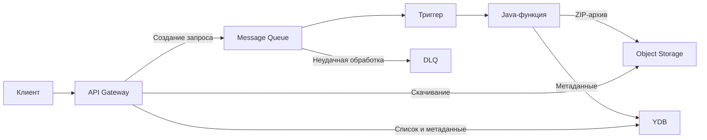

# Archive System

Облачный сервис для асинхронного архивирования файлов по URL. Сервис скачивает
файл, упаковывает его в ZIP, сохраняет в приватное хранилище и предоставляет HTTP API
для просмотра и скачивания архивов.

Стек: Java 21, Yandex Cloud Functions, API Gateway, Message Queue, YDB,
Object Storage и Terraform.

## Как работает сервис



Клиент передаёт имя файла и URL в `POST /tasks`. API проверяет запрос, отправляет
его в очередь и возвращает `202 Accepted` с пустым телом. Обработка выполняется
асинхронно: этот ответ подтверждает приём запроса.

Триггер получает одно сообщение и вызывает функцию. Функция скачивает файл,
создаёт ZIP с ключом `<uuid_v7>.zip`, загружает архив в Object Storage, затем
сохраняет поля `name`, `url` и `key` в документную таблицу YDB `archives`.
Внутри ZIP находится один файл с указанным клиентом именем.

После успешной обработки триггер удаляет сообщение. При ошибке сообщение
переносится в очередь необработанных сообщений — DLQ. Политика очереди допускает
одну попытку получения; повторная попытка после таймаута видимости приводит
к переносу в DLQ. При текущих настройках это занимает примерно 15 минут
после первого получения сообщения.

## Развёртывание

Понадобятся:

- Terraform версии `>= 1.7, < 2.0`;
- облако и каталог Yandex Cloud;
- IAM-токен аккаунта с правами создавать ресурсы и назначать роли в каталоге;
- глобально уникальное имя бакета.

Команды ниже выполняются из корня репозитория. В Bash или WSL передайте токен
через переменную окружения:

```bash
export YC_TOKEN="<IAM_TOKEN>"
```

Инициализируйте Terraform и создайте инфраструктуру:

```bash
terraform -chdir=terraform init
terraform -chdir=terraform apply \
  -var="cloud_id=YOUR_CLOUD_ID" \
  -var="folder_id=YOUR_FOLDER_ID" \
  -var="bucket_name=vvot11-your-unique-bucket"
```

| Переменная | Значение |
| --- | --- |
| `cloud_id` | Идентификатор облака Yandex Cloud |
| `folder_id` | Идентификатор каталога для ресурсов сервиса |
| `bucket_name` | Глобально уникальное имя приватного бакета |

Валидация имени бакета принимает префикс `vvotNN-`, где `NN` — две цифры.
Полное имя должно содержать от 8 до 63 строчных латинских букв, цифр и дефисов
и заканчиваться буквой или цифрой. Префикс имён сервисных аккаунтов, очередей,
базы, функции, триггера и API Gateway — `vvot11-`; он задан в `terraform/iam.tf`.

Terraform создаёт сервисные аккаунты, назначает роли и разворачивает все ресурсы.
Исходники функции упаковываются Terraform, а компиляция и загрузка зависимостей
выполняются в Cloud Functions через Maven. Для развёртывания достаточно Terraform
и доступа к Yandex Cloud; JDK и Gradle используются при локальной разработке.

Провайдер `hashicorp/aws` обращается к совместимому Document API YDB. Все ресурсы
создаются в Yandex Cloud. Статический ключ для управления очередями и таблицей
выпускается Terraform; функция получает IAM-токен через сервис метаданных.
Файл `terraform/aws-bootstrap-credentials` содержит технические заглушки для
первоначального плана, когда созданный ключ ещё неизвестен.

После развёртывания Terraform выводит адрес API, имя бакета, идентификаторы базы
и функции, а также URL основной очереди и DLQ. Получить адрес API отдельно:

```bash
terraform -chdir=terraform output -raw api_url
```

Первая сборка функции и запуск триггера могут занять несколько минут.

## API

Контракт запросов, ответов и интеграций описан в [openapi.yaml](openapi.yaml).
Базовый адрес — значение Terraform output `api_url`.

| Метод и путь | Результат |
| --- | --- |
| `POST /tasks` | `202`: запрос принят в очередь; `400`: некорректный запрос |
| `GET /archives` | `200`: JSON-массив объектов с полями `name`, `url`, `key` |
| `GET /archives/{key}` | `200`: JSON с метаданными; `404`: запись отсутствует |
| `GET /download/{key}` | `200`: ZIP-архив; `404`: файл отсутствует |

Тело запроса на архивирование:

```json
{
  "name": "document.pdf",
  "url": "https://example.com/document.pdf"
}
```

Оба поля обязательны. В `url` укажите прямую HTTP- или HTTPS-ссылку на файл;
адрес выше служит примером. `name` задаёт имя файла внутри ZIP.

Пока архивов нет, `GET /archives` возвращает `[]`. При отсутствии записи
`GET /archives/{key}` возвращает JSON с полем `message`. При отсутствии файла
`GET /download/{key}` передаёт XML-ответ Object Storage с кодом `NoSuchKey`.

HTTP API доступен без клиентской аутентификации. Бакет приватный: API Gateway
и функция обращаются к облачным ресурсам от имени сервисных аккаунтов.

## Конфигурация ресурсов

| Ресурс | Настройки |
| --- | --- |
| Функция | Java 21, 256 МБ памяти, таймаут 600 с |
| Триггер | Одно сообщение на вызов, время группировки 0 с |
| Основная очередь | Видимость 900 с, ожидание при получении 20 с, хранение 1 сутки |
| DLQ | Хранение сообщений 14 суток |
| YDB | Serverless, ограничение пропускной способности 10 RU/с, объём 1 ГБ |
| Object Storage | Приватный бакет, максимальный размер 10 ГБ |

## Разработка и тестирование

Для локальной разработки нужен JDK 21. Проект использует Gradle Wrapper.

```bash
./gradlew test
```

В PowerShell используйте `.\gradlew.bat test`.
HTML-отчёт создаётся в `build/reports/tests/test/index.html`.

Java-тесты запускают локальный HTTP-сервер и проверяют архивирование текстового,
бинарного и пустого файла, содержимое ZIP, UUIDv7, метаданные, некорректные
запросы, ошибки скачивания и базы данных, а также прерывание обработки.

Для проверки Terraform после `init`:

```bash
terraform -chdir=terraform validate
terraform -chdir=terraform test
```

Terraform-тесты проверяют связи ресурсов, упаковку исходников, валидацию входных
переменных и первоначальный план с ещё неизвестным ключом. Облачные сервисы
подменяются; проверка первоначального плана использует адрес localhost.
Эти тесты работают локально и не создают ресурсов в облаке.

Исходники тестов хранятся в `src/test/java`, проверки инфраструктуры —
в `terraform/tests`. В облачный пакет включаются основной Java-код и `pom.xml`.
Точка входа функции — `ru.itis.handler.ArchiveHandler`.

Для дополнительной локальной сборки пакета с JAR и зависимостями доступна команда
`./gradlew functionZip`. Результат — `build/distributions/function.zip`.
Развёртывание Terraform использует отдельный архив исходников.

## Структура проекта

Пакеты Java находятся в `src/main/java/ru/itis`.

| Путь или пакет | Назначение |
| --- | --- |
| `openapi.yaml` | Контракт API и интеграции API Gateway |
| `terraform/` | Инфраструктура и упаковка функции для облачной сборки |
| `handler` | Точка входа и разбор события очереди |
| `model` | Модели запроса и метаданных |
| `service` | Скачивание, архивирование и сохранение |
| `port` | Интерфейсы скачивания, хранилища и репозитория |
| `infrastructure` | HTTP-клиенты облачных сервисов и источника файла |
| `config` | Настройка и связывание компонентов |
| `exception` | Исключения приложения |

## Удаление и повторное развёртывание

Удаление ресурсов выполняется командой:

```bash
terraform -chdir=terraform destroy
```

По умолчанию непустой бакет защищён от удаления. Чтобы удалить его вместе
с архивами, добавьте `force_destroy = true` в ресурс `yandex_storage_bucket.archives`
в `terraform/main.tf`, примените изменение через `terraform apply`, затем
повторите `terraform destroy`. Для команд из корня используйте `-chdir=terraform`.

**Удаление ресурсов уничтожает архивы, метаданные и сообщения очередей.**
Сохраняйте локальное состояние Terraform до полного завершения удаления.
Для повторного развёртывания выполните `terraform -chdir=terraform apply`:
сервис будет создан с пустым хранилищем. Адрес API и идентификаторы могут измениться.

IAM-токен передаётся через окружение. Terraform state содержит созданный секретный
ключ; state, планы, локальные параметры и каталог `.terraform` исключены из Git.

## Ссылки

- [Документные таблицы YDB через Terraform](https://yandex.cloud/ru/docs/ydb/terraform/dynamodb-tables)
- [Сборка Java-функции через Maven](https://yandex.cloud/ru/docs/functions/lang/java/dependencies)
